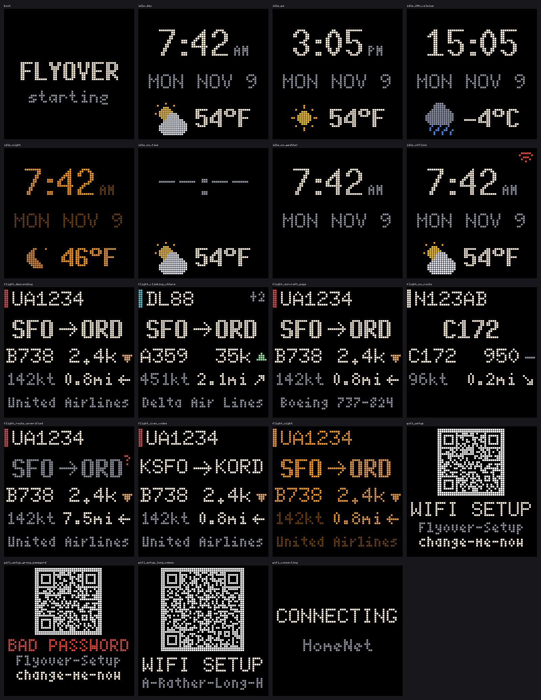
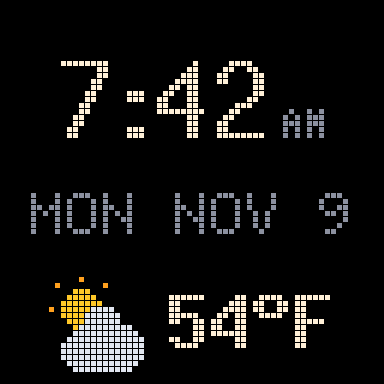
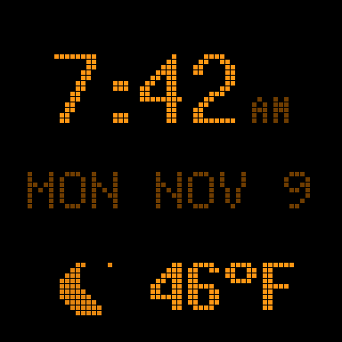
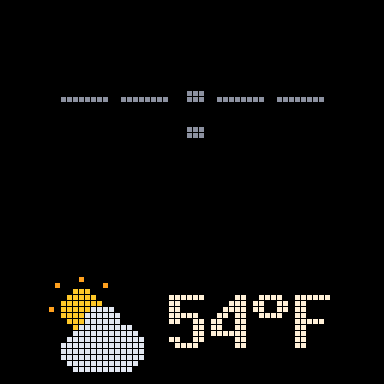
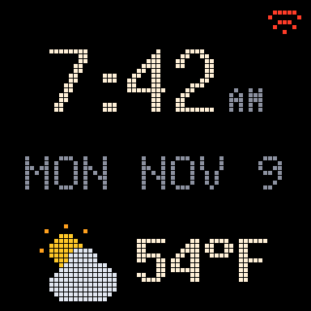
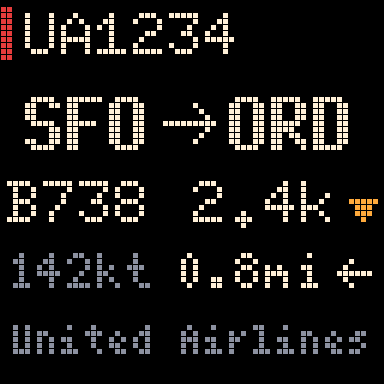
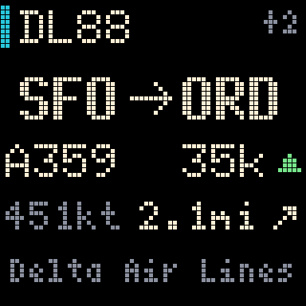
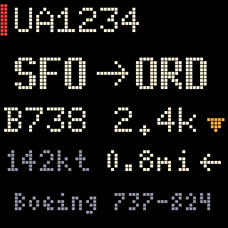
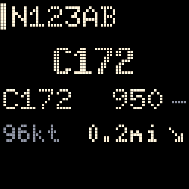
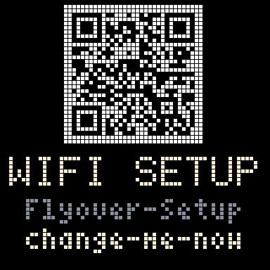

# Flyover

A small LED display that shows the aircraft passing overhead: flight number, origin → destination, aircraft type, altitude and speed. When nothing is overhead it shows the time, date and temperature.

It runs on a Raspberry Pi Zero 2 W driving a 64x64 RGB LED matrix. It sets up its own Wi-Fi: with no connection it opens a hotspot and a phone-friendly setup page, so it can be handed to someone without knowing their network details in advance.



> The pictures above are rendered by the code itself (`python -m flyover.display.gallery`), pixel for pixel what the panel is asked to show. They are not photos of hardware.

## Contents

1. [Status](#status)
2. [Hardware](#hardware)
3. [Raspberry Pi setup](#raspberry-pi-setup)
4. [Install](#install)
5. [What to change for your install](#what-to-change-for-your-install)
6. [Configuration reference](#configuration-reference)
7. [Behaviour](#behaviour)
8. [Architecture](#architecture)
9. [Data sources](#data-sources)
10. [Development](#development)
11. [Operations](#operations)
12. [Troubleshooting](#troubleshooting)
13. [Adapting to other hardware](#adapting-to-other-hardware)
14. [Not built yet](#not-built-yet)
15. [Credits and licence](#credits-and-licence)

---

## Status

All of the software is written and covered by automated tests (`pytest`, run in CI). It has been built without access to a Pi, a panel, or the live data services, so each part is marked by how far it has been checked.

| Area | Automated tests | Checked on real hardware or live services |
|---|---|---|
| Config, state files, clock and time zone | Yes | n/a |
| Screens (idle, flight, Wi-Fi setup, boot) | Yes, pixel snapshots | Not yet: needs the panel |
| Weather, flight positions, route lookup | Yes, against sample replies built from the documented formats | **Not yet**: live replies may differ in small ways |
| Overhead selection, hold time, route check | Yes | Not yet: tune the radius on site |
| Network state machine, hotspot and portal logic | Yes, against a simulated NetworkManager | **Not yet**: needs a Pi and a phone |
| Web UI (status, settings, Wi-Fi) | Yes, against a real HTTP server | Not yet on a phone |
| `install.sh`, systemd units | File edits tested; the script itself has not run | **Not yet**: needs Raspberry Pi OS |
| LED matrix backend | Yes, against a stand-in for the driver | **Not yet**: needs the panel; tuning values are starting points |

`docs/PI_INTEGRATION.md` lists exactly what to verify on the device, in what order, and where to fix each likely failure.

---

## Hardware

### Bill of materials

| Part | Notes |
|---|---|
| Raspberry Pi Zero 2 W, with header pins | The original Zero W is not supported; see [Adapting to other hardware](#adapting-to-other-hardware). |
| Adafruit RGB Matrix Bonnet for Raspberry Pi (product 3211) | Level-shifts the Pi's 3.3 V signals to the panel's 5 V and powers both the panel and the Pi from one supply. |
| 64x64 RGB LED matrix panel, 2.5 mm pitch, HUB75 connector with address line E | 160 × 160 mm. Sold as "P2.5 64x64". Comes with a 16-pin ribbon cable and a power cable. |
| 5 V DC power supply, 4 A or more, 2.1 mm barrel plug | Plugs into the bonnet. |
| microSD card, 8 GB or more | |
| Smoked (tinted) acrylic sheet, 160 × 160 mm, about 3 mm thick | Optional but recommended: it raises contrast and hides the glow around lit pixels. |

### Power

- The bonnet's barrel jack powers the panel and back-powers the Pi through the header. Do not connect a second supply to the Pi's USB power port.
- Never power the panel from the Pi's 5 V pins.
- Panels of this size are typically rated around 4 A at 5 V with every pixel white at full brightness. Check your panel's listing. **Verify on panel.**
- Flyover's screens are mostly black and brightness is capped in config, so real draw should be well below the rating. Measure before choosing a smaller supply.

### Bonnet modifications

Two solder jobs on the bonnet. The first is required for this panel.

1. **Address E jumper (required for 64x64).**
   - A 64x64 panel needs a fifth address line, called E. The bonnet leaves it unconnected by default.
   - The bonnet has three pads labelled `8`, `E` and `16`. Bridge `E` to `8` with a blob of solder.
   - `8` is the usual position for this connector. If the lower half of the picture is garbled or mirrors the top half, remove the blob and bridge `E` to `16`. **Verify on panel.**
2. **PWM jumper (optional, reduces flicker).**
   - Solder a short wire between the pads for GPIO4 and GPIO18.
   - Then set `hardware_mapping = "adafruit-hat-pwm"` in the config. Without the wire, use `"adafruit-hat"`.

### Assembly

1. Do the solder jobs above before fitting the bonnet.
2. Push the bonnet onto the Pi's 40-pin header.
3. Connect the ribbon cable from the bonnet to the panel's **input** connector. Arrows printed on the back of the panel point from input to output.
4. Screw the panel's power cable into the bonnet's terminals: red to `+`, black to `-`.
5. Mount the acrylic a few millimetres in front of the LEDs.
6. Plug the 5 V supply into the bonnet last.

### Picture quality

Two different effects make lit pixels appear to spill into their neighbours.

| Effect | What it looks like | Fix |
|---|---|---|
| Electrical ghosting | Faint copies of bright pixels on other rows or columns | Raise `gpio_slowdown`, adjust `pwm_lsb_nanoseconds`, fit the PWM jumper |
| Optical bleed | A soft glow around each lit pixel | Smoked acrylic in front; optionally a printed grid between the LEDs and the acrylic |

The screens also use bitmap fonts with no smoothing and avoid pure white, which reduces both effects.

---

## Raspberry Pi setup

### Flash the SD card

Use Raspberry Pi Imager.

1. Device: **Raspberry Pi Zero 2 W**.
2. Operating system: **Raspberry Pi OS Lite (64-bit)**. It has no desktop and uses NetworkManager for Wi-Fi, which Flyover requires.
3. In the customisation settings:
   - **Hostname:** `flyover`. The device is then reachable as `flyover.local`.
   - **Username and password:** your choice.
   - **Wi-Fi:** a network you can reach for first setup, such as your own or a phone hotspot. Set the **Wi-Fi country** correctly: the setup hotspot will not start without it.
   - **Locale:** your keyboard layout.
   - **SSH:** enabled, with your public key.
4. Write the card, insert it, and power the Pi.

### Check access

```bash
ssh <user>@flyover.local
```

### Limits to know about

- **The Zero 2 W's radio is 2.4 GHz only.** It cannot see or join 5 GHz networks. Most home routers broadcast both.
- **It has no battery-backed clock.** After a power cut it does not know the time until it reaches the internet. Flyover shows `--:--` until then.

---

## Install

On the Pi:

```bash
sudo apt-get update && sudo apt-get install -y git
```

```bash
sudo git clone https://github.com/Jordie-L/flyover.git /opt/flyover
```

```bash
cd /opt/flyover && sudo deploy/install.sh
```

With no panel attached yet, add `--no-matrix` (the display then runs in preview mode, which the web UI shows):

```bash
cd /opt/flyover && sudo deploy/install.sh --no-matrix
```

Reboot when the script says so, then open `http://flyover.local/`. The page shows a live picture of what the panel is displaying, whether or not a panel is attached. Set the location under **Settings**.

### Installer options

| Option | Effect |
|---|---|
| `--no-matrix` | Skip the LED driver and the boot settings it needs. |
| `--volatile-logs` | Keep the system journal in RAM, to spare the SD card. |
| `--no-watchdog` | Do not enable the hardware watchdog. |

### What the installer does

The script is safe to run again, which is also how you update. Each step can be done by hand. Run it from a checkout outside `/home`, `/root` and `/run/user`: the services run with `ProtectHome=yes` and could not see their own code there, so the script refuses (clone to `/opt/flyover`, as above).

| Step | Action |
|---|---|
| 1 | Installs system packages: Python virtual-environment support, git, `iw`, `dnsmasq-base`, and (unless `--no-matrix`) a C++ compiler and CMake. |
| 2 | Creates a Python virtual environment at `.venv` in the checkout and installs Flyover into it. |
| 3 | Fetches the [rpi-rgb-led-matrix](https://github.com/hzeller/rpi-rgb-led-matrix) driver at a pinned commit and installs its Python binding into that environment with `pip install` (it compiles C++, so allow several minutes on the Zero 2 W), then checks that `import rgbmatrix` works. |
| 4 | Turns off onboard audio (`dtparam=audio=off` in `/boot/firmware/config.txt`, and a blacklist for `snd_bcm2835`): the matrix driver refuses to start while it is loaded. |
| 5 | Reserves one CPU core for the panel refresh thread by appending `isolcpus=domain,managed_irq,3 nohz_full=3 rcu_nocbs=3 irqaffinity=0,1,2` to the single line of `/boot/firmware/cmdline.txt`. |
| 6 | Creates `/etc/flyover`, `/var/lib/flyover` (owned by `daemon`) and a boot-time rule that creates `/run/flyover` shared between the two services. |
| 7 | Copies `config.example.toml` to `/etc/flyover/config.toml` if there is none, and replaces the placeholder hotspot password with a random one, which it prints. |
| 8 | Adds a DNS rule at `/etc/NetworkManager/dnsmasq-shared.d/flyover.conf` so that every name resolves to the Pi while a phone is on the setup hotspot. |
| 9 | Enables the hardware watchdog (`RuntimeWatchdogSec=15`), and with `--volatile-logs` RAM-only logs. |
| 10 | Installs, enables and starts `flyover-display` and `flyover-control`, then warns if no Wi-Fi country is set. |

Steps 4 and 5 need a reboot to take effect.

---

## What to change for your install

Everything specific to one installation lives in `/etc/flyover/config.toml`. Nothing in the code needs editing. Most of it can be changed on the web UI's **Settings** page, which edits the file in place and keeps its comments.

| Setting | Key | Change it? |
|---|---|---|
| Where the display is | `[location] latitude`, `longitude` | **Always.** Settings page: paste "lat, lon" copied from a maps app. |
| Hotspot name and password | `[hotspot] ssid`, `password` | The installer generates the password. Change the name if you like. |
| How far out to look | `[flights] radius_km`, `max_altitude_ft` | Tune after watching a few passes. |
| Units and clock style | `[display] temperature_unit`, `distance_unit`, `clock_24h` | To taste. |
| Brightness and night hours | `[display] brightness`, `night_*`, `quiet_*` | To taste. |
| Matrix wiring | `[matrix] hardware_mapping` | Only if you fitted the PWM jumper. |
| Matrix timing | `[matrix] gpio_slowdown` and the other timing keys | Only if the picture flickers or ghosts. |

The home Wi-Fi name and password are **not** in this file. They are entered on the setup page and stored by NetworkManager.

---

## Configuration reference

The full file with defaults.

```toml
[location]
latitude  = 0.0            # decimal degrees, north positive
longitude = 0.0            # decimal degrees, east positive
# timezone = "America/Chicago"   # optional; by default it is looked up from the coordinates

[flights]
provider         = "airplanes_live"   # or "adsb_lol"
radius_km        = 4.0     # a plane inside this circle counts as overhead
max_altitude_ft  = 15000   # ignore anything higher
hold_seconds     = 10      # keep showing a plane this long after it leaves the circle
poll_idle_s      = 10      # seconds between position requests when nothing is near
poll_active_s    = 5       # seconds between requests when a plane is near
route_cache_days = 7       # how long a looked-up route is remembered

[display]
backend          = "auto"  # "auto", "matrix" or "preview"; auto uses the matrix when its library is installed
brightness       = 60      # percent, daytime (the maximum when auto_brightness is on)
auto_brightness  = false   # by day, dim from this down to auto_brightness_min as the sun sets
auto_brightness_min = 30   # percent; the dimmest daytime level (night_* still applies at night)
night_brightness = 15      # percent
night_start      = "22:00" # local time; dim and switch to amber
night_end        = "07:00"
quiet_start      = ""      # optional; panel fully off between these times
quiet_end        = ""
clock_24h        = false
temperature_unit = "F"     # "F" or "C"
distance_unit    = "mi"    # "mi" or "km"; altitude is always feet and speed always knots

[matrix]
rows                = 64
cols                = 64
hardware_mapping    = "adafruit-hat"  # "adafruit-hat-pwm" with the PWM jumper fitted
gpio_slowdown       = 2    # raise if the picture is unstable or ghosts
pwm_bits            = 11   # lower gives a faster refresh and fewer colour steps
pwm_lsb_nanoseconds = 130  # raise to reduce ghosting at the cost of refresh rate
limit_refresh_hz    = 0    # 0 = no limit; a fixed value can remove a faint flicker
panel_type          = ""   # "FM6126A" if the panel stays dark
row_addr_type       = 0
rgb_sequence        = "RGB" # change if colours are swapped

[hotspot]
ssid          = "Flyover-Setup"
password      = "change-me-now"  # 8-63 characters
retry_minutes = 5          # how often to retry saved networks while the hotspot is idle

[network]
boot_timeout_s           = 60   # how long to wait for a saved network at boot
check_interval_s         = 30   # how often to test the connection
failures_before_degraded = 3    # consecutive failed tests before reacting
degraded_timeout_s       = 180  # how long to wait for a reconnect before opening the hotspot

[web]
port = 80
```

The `[matrix]` defaults are starting values. **Verify on panel.**

---

## Behaviour

### Screens

The panel is 64 × 64 pixels. Every screen below is rendered by the code (6× enlarged, with a grid so single pixels show).

**Idle** (nothing overhead): large clock, date, and the weather with an icon. The weather is hidden once it is over an hour old.

| Day | Night (amber, dimmer) | Time not synced yet | Offline (red Wi-Fi mark) |
|---|---|---|---|
|  |  |  |  |

**Flight** (an aircraft is overhead)

| Descending | Climbing, 2 more in range | Aircraft details | No route known |
|---|---|---|---|
|  |  |  |  |

Rows, top to bottom:

1. Flight number, with a bar in the airline's colour. `+N` at the right when other aircraft are also in range.
2. Origin → destination (IATA codes; ICAO when there is no IATA code). Dimmed with a red `?` when the position does not fit the stored route.
3. Aircraft type, altitude (`850`, `2.4k`, `35k` feet), and a mark: green triangle up when climbing, amber triangle down when descending, dash when level.
4. Ground speed in knots, distance from the display, and an arrow for the direction of travel.
5. Airline name, alternating every 4 seconds with the aircraft model (`Boeing 737-824`).

With no route found (private and military aircraft), the big line shows the registration or type instead.

**Wi-Fi setup** (hotspot is open): a QR code that joins the hotspot, the hotspot name and its password. After a failed attempt the title is replaced by `BAD PASSWORD` or `TRY AGAIN`.

| Setup | After a wrong password | Connecting |
|---|---|---|
|  |  |  |

**Other states**

| State | What is shown |
|---|---|
| Connected to Wi-Fi but no internet | The normal screens with a small red Wi-Fi mark in the corner. |
| Time not yet known | `--:--` in place of the clock. |
| Night hours | Reduced brightness, amber only (the QR code stays black on white so phones can read it). |
| Daylight dimming (optional) | With `auto_brightness = true`, daytime brightness follows the sun's height, worked out from the location and the clock (no network needed): `brightness` at full day, falling to `auto_brightness_min` through dusk. Night mode still uses `night_brightness`. |
| Quiet hours | Panel off. Flight requests are paused. |

### Which plane is shown

1. Ask the flight data service for aircraft in a circle around the configured location, a little larger than the radius so approaching aircraft are already known.
2. Discard aircraft on the ground, with no altitude, or above `max_altitude_ft`.
3. Between requests, move each aircraft forward along its heading at its reported speed (for up to 60 seconds). A jet covers about a kilometre between requests, so this keeps the timing and the distance readout accurate.
4. An aircraft is "overhead" while it is inside `radius_km`.
5. If several are overhead, show the closest and a `+N` count. The aircraft already shown is only replaced by one that is clearly closer (under 70% of its distance), so two aircraft at similar distances do not flip back and forth.
6. Keep showing an aircraft for `hold_seconds` after it leaves, unless another has arrived.

What is shown for each aircraft:

- **Flight number.** The form printed on a ticket (`UA1234`) when the lookup returns it. Otherwise the radio callsign (`UAL1234`).
- **Route check.** Route databases key on the flight number, and airlines reuse numbers. If the aircraft is further from the line between the two airports than 150 km (or a fifth of the route length, if larger), the route is dimmed and marked `?`.
- **No route found:** the registration and aircraft type instead.

### Network states

```
BOOT      Try saved networks for boot_timeout_s.
          Connected -> ONLINE.  Connected but no internet -> DEGRADED.  Nothing -> scan, then HOTSPOT.

ONLINE    Test the connection every check_interval_s.
          failures_before_degraded misses in a row -> DEGRADED.

DEGRADED  Test every 10 s while NetworkManager tries to reconnect.
          Reconnected -> ONLINE.  Still down after degraded_timeout_s -> scan, then HOTSPOT.

HOTSPOT   Open the setup hotspot and serve the setup page.
          Credentials submitted -> CONNECTING.
          Every retry_minutes, if no device is connected to the hotspot:
              close it briefly and retry saved networks.  Joined -> ONLINE.  Otherwise rescan and reopen.

CONNECTING  Close the hotspot and join the chosen network (about 10 to 60 seconds).
          Joined -> ONLINE.  Failed -> back to HOTSPOT (or the previous network) with the reason shown.
```

- "Internet works" means a TCP connection to one of three well-known public addresses (1.1.1.1, 9.9.9.9, 8.8.8.8, port 443) succeeds. DNS is deliberately not part of the test, and nothing about this device is sent.
- The retry rule covers a router that was simply rebooting: the display rejoins without anyone touching it.
- The hotspot is never closed while a device is connected to it, so setup is not interrupted.

### Setting up Wi-Fi

1. The panel shows the Wi-Fi setup screen. With no panel attached, the hotspot name and password are the ones in `config.toml` (the installer prints the password).
2. On a phone, scan the QR code, or join the hotspot by name and password.
3. The phone opens the setup page by itself (the "sign in to network" prompt). If it does not, browse to `http://10.42.0.1/`.
4. Pick the home network from the dropdown, enter its password, and submit. For a hidden network, type its name and tick "Hidden network".
5. The hotspot closes while the Pi tries to join, so the phone drops off. On success the panel returns to the idle screen. On failure the hotspot reopens (rejoin it; most phones do so by themselves) and the page shows why.

Details:

- The Pi has one radio and cannot scan while it is acting as a hotspot. Networks are scanned just before the hotspot opens. **Scan again** closes the hotspot for about 15 seconds.
- The hotspot is password-protected (WPA2), so the home Wi-Fi password is not sent over an open network.
- Only 2.4 GHz networks appear in the list.
- The same page, under the **Wi-Fi** link, changes networks later from the home network.

---

## Architecture

### Two services

```
flyover-display     starts as root to claim the panel, then drops to the `daemon` user
    fetches flights, routes and weather in background threads
    picks the overhead aircraft, draws the current screen, sends it to the panel
    reads   /etc/flyover/config.toml  (re-read when it changes)
            /run/flyover/net.json
    writes  /run/flyover/frame.png     the current screen, for the web preview
            /run/flyover/status.json   what it is showing, and whether its data sources are healthy
            /var/lib/flyover/          route cache (SQLite) and the last known time zone

flyover-control     runs as root
    web UI on port 80:  /  /settings  /wifi  /frame.png  /api/status  /api/net
    network state machine (the only code that runs nmcli)
    reads   /run/flyover/frame.png, /run/flyover/status.json
    writes  /etc/flyover/config.toml    in place, atomically, keeping comments
            /run/flyover/net.json       network state and hotspot details
```

Why two and not one:

- The matrix driver needs root only to claim the hardware; the display then drops to an unprivileged user, because it parses data from the internet. Joining networks, opening a hotspot and binding port 80 need root, so they live in the other service.
- A crash in the web UI must not blank the panel, and the reverse.

Why not three: the Wi-Fi page and the network state machine both change the network. In one process they share a lock, so only one thing is ever changing it.

The services exchange plain files and nothing else. Both read the config through the same `ConfigStore`, which keeps the last good configuration if a hand edit leaves the file invalid.

Why the web UI uses the standard library rather than a framework: the pages are small and used by one person at a time, and a framework costs memory and install time on a 512 MB board.

### Display backends

Every screen is drawn as a 64 × 64 image in memory. A backend then delivers it.

| Backend | Delivers to | Used for |
|---|---|---|
| `matrix` | The LED panel (and the preview file) | The finished device |
| `preview` | `/run/flyover/frame.png`, shown on the web UI | A Pi with no panel, a laptop, and remote checks |
| `png` | Memory, optionally files | Automated tests |

`auto` uses the matrix when the driver's Python module imports, otherwise the preview. Asking for `matrix` without the driver is an error rather than a silent fallback.

### Source layout

```
flyover/
  config.py            typed config, validation, ConfigStore (reloads on change)
  state.py             the files in /run/flyover: atomic writes, tolerant reads
  clock.py             is the time trustworthy, which time zone
  geo.py               distance, bearing, dead reckoning, distance from a route line
  models.py            Aircraft, Airport, RouteInfo, FlightView
  selector.py          choose the overhead aircraft
  providers/
    http.py            JSON GET on the standard library
    poller.py          background fetch with backoff; the pace may adapt
    weather.py         Open-Meteo
    flights.py         aircraft positions (airplanes.live / adsb.lol)
    routes.py          flight number, route, aircraft (adsbdb), SQLite cache
  display/
    app.py             main loop and scene choice
    scenes/            idle, flight, wifi_setup, boot (each a pure function of a Context)
    backends/          matrix, preview, png
    fonts.py icons.py draw.py theme.py   BDF renderer, weather icons, arrows, day/night palettes
    privileges.py      drop root after the hardware is claimed
    samples.py gallery.py                every screen in a fixed state, for docs and tests
  control/
    app.py             starts the web server and the network watcher
    web.py pages.py    HTTP handlers and HTML
    netwatch.py        the state machine
    nm.py              the nmcli wrapper, plus a fake for tests and --fake-network
    config_edit.py     comment-preserving edits to config.toml
fonts/                 bitmap fonts (X11 "misc-fixed", public domain)
deploy/                install.sh, systemd units, tmpfiles rule, NetworkManager DNS rule
docs/                  rendered screens, PI_INTEGRATION.md
tests/                 unit, snapshot and end-to-end tests; fixtures/ holds sample API replies
config.example.toml
pyproject.toml
```

### Extending

| To add | Do this |
|---|---|
| A screen | Add a module in `display/scenes/` with a `name` and a `render(ctx)` that returns a 64 × 64 image, add a sample to `display/samples.py`, and choose it in `DisplayApp._choose_scene`. |
| A flight data source | Add its URL to `providers/flights.py` if it speaks the same format, or a parser if not, and name it in `[flights] provider` (and in `config._validate`). |
| A display type | Add a module in `display/backends/` that implements `show(image, brightness)` and `close()`, and select it in `backends/__init__.py`. |

### Network commands used

`control/nm.py` wraps the `nmcli` tool. Running these by hand is the quickest way to debug.

| Purpose | Command |
|---|---|
| List networks | `nmcli -t -f SSID,SIGNAL,SECURITY device wifi list ifname wlan0 --rescan yes` |
| Name of the joined network | `nmcli -t -f ACTIVE,SSID device wifi list ifname wlan0 --rescan no` |
| Join a network | `nmcli device wifi connect "<ssid>" ifname wlan0 password "<password>"` |
| Rejoin a saved network | `nmcli device connect wlan0` |
| Open the hotspot | `nmcli device wifi hotspot ifname wlan0 con-name Flyover-Hotspot ssid "<ssid>" password "<password>" band bg` |
| Keep NetworkManager from opening it on its own | `nmcli connection modify Flyover-Hotspot connection.autoconnect no` |
| Close the hotspot | `nmcli connection down id Flyover-Hotspot` |
| Devices on the hotspot | `iw dev wlan0 station dump` |

The hotspot uses NetworkManager's "shared" mode: the Pi takes the address `10.42.0.1` and hands out addresses to devices that join. The installed DNS rule makes every hostname resolve to the Pi, and the web UI redirects every request except the setup page to `/wifi` while the hotspot is up. Together these trigger the phone's sign-in prompt.

### Security

- The web UI has no login. Anyone on the same network can change the settings. This suits a home network; do not expose port 80 to the internet.
- Home Wi-Fi credentials are stored by NetworkManager in files only root can read. They are never written to `config.toml`, the logs or the web pages.
- While `nmcli` joins a network, the password is visible in the process list to other local users for a few seconds. The Pi has no other users.
- The hotspot password is in `config.toml` and `net.json`, which are world-readable: the display needs it to draw the QR code.
- The web UI refuses requests that look like they came from another web site (a wrong `Origin`, or a `Host` that is not an IP address, `localhost`, a single-label name or `*.local`). That blocks cross-site form posts and DNS rebinding, but it is not a login: reach the device by IP address, `flyover.local` or its hostname.
- The setup hotspot will not start while `[hotspot] password` is still the example value `change-me-now`; the installer replaces it.
- Pages escape every dynamic value, send a restrictive Content-Security-Policy, and refuse form bodies over 8 KB.
- Keep your edited `config.toml` out of version control: it holds your location and hotspot password. (The repository's `.gitignore` excludes a `config.toml` in the repository root.)

---

## Data sources

All three are free and need no account.

| Data | Service | Request |
|---|---|---|
| Aircraft positions | [airplanes.live](https://airplanes.live) | `GET https://api.airplanes.live/v2/point/{lat}/{lon}/{radius_nm}` |
| Positions, alternative | [adsb.lol](https://adsb.lol) | `GET https://api.adsb.lol/v2/point/{lat}/{lon}/{radius_nm}` |
| Route, flight number, aircraft | [adsbdb](https://www.adsbdb.com) | `GET https://api.adsbdb.com/v0/aircraft/{hex}?callsign={callsign}`, then `GET .../v0/callsign/{callsign}` if the aircraft is unknown |
| Weather and time zone | [Open-Meteo](https://open-meteo.com) | `GET https://api.open-meteo.com/v1/forecast?latitude={lat}&longitude={lon}&current=temperature_2m,weather_code,is_day&timezone=auto` |

Notes:

- **Positions.** Both position services return the same format. Radius is in nautical miles. Fields used: `hex` (the aircraft's unique radio address), `flight` (callsign), `r` (registration), `t` (type), `lat`, `lon`, `alt_baro` (a number, or `"ground"`), `gs` (ground speed), `track`, `baro_rate`, `seen_pos`. The airplanes.live endpoint and its rate limit were written from memory and are to be confirmed on the first live run.
- **adsb.lol** has announced that it will require an API key in future, issued to people who contribute receiver data. It is offered as an alternative, not as an automatic fallback.
- **Routes.** One request per newly seen aircraft returns the aircraft details and the route together. Results are cached for `route_cache_days`, in memory and in SQLite, so a restart does not ask again; "not found" is cached for 6 hours. A failed request is retried after a minute. Lookups run one at a time in the background, at most one a second.
- **Weather.** Refreshed every 15 minutes. The response also names the time zone for the coordinates, which Flyover uses for the clock and stores for the next offline start.
- **Privacy.** Requests carry only the coordinates they need, and a generic `User-Agent` (`pi-display-client/0.1`). Error messages and logs name the host, never the URL.

### Request volume

These are community services, so Flyover keeps its footprint small.

- One position request every 10 seconds when idle, every 5 seconds while an aircraft is within reach. About 9,000 requests a day at most.
- No position requests during quiet hours.
- After an error, the wait doubles on each failure up to 5 minutes, then returns to normal after one success.

### When a source is down

| Source down | Effect |
|---|---|
| Positions | Idle screen stays up. No flights are shown. |
| Routes | Flights are shown with callsign, type, altitude and speed, without origin and destination. |
| Weather | The temperature is hidden once the last reading is an hour old. |

---

## Development

Flyover runs on any computer with Python 3.11 or newer; no Pi or panel is needed for most work.

```bash
python3 -m venv .venv && . .venv/bin/activate
```

```bash
pip install -e ".[dev]"
```

Run the display with the preview backend (it writes `run/frame.png`):

```bash
python -m flyover.display --config config.example.toml --backend preview --run-dir ./run --data-dir ./data
```

Run the control service against a simulated network manager, then open `http://localhost:8080/`:

```bash
python -m flyover.control --config config.example.toml --run-dir ./run --fake-network --port 8080
```

Both write into `./run`, so the web UI shows the live preview. Use your own copy of the config (with your coordinates) rather than editing `config.example.toml`: the settings page edits whichever file it is given.

The setup hotspot refuses to open with the example password, so to see the Wi-Fi setup flow in `--fake-network` mode, give your copy a password first:

```bash
python -m flyover.control.config_edit my-config.toml hotspot.password=any-8-to-63-characters
```

Render every screen:

```bash
python -m flyover.display.gallery --out docs/screens
```

Run the tests:

```bash
pytest
```

What the tests cover:

- Config validation (including a check that the config block in this README matches `config.example.toml`), and the comment-preserving config editor.
- Fonts, icons, themes, and one pixel snapshot per screen in `tests/snapshots/`. After an intentional change to a screen, regenerate them with `UPDATE_SNAPSHOTS=1 pytest tests/test_scenes_app.py` and look at the result before committing.
- Flight replies, dead reckoning, selection and hold time, route plausibility, and the route resolver with its SQLite cache, using sample replies in `tests/fixtures/`. No test touches the network.
- The network state machine against a simulated NetworkManager, the `nmcli` command construction against a fake subprocess, and the web UI against a real HTTP server on a local port.
- The display loop end to end, the LED matrix backend against a stand-in for the driver, and every file edit the installer makes.

---

## Operations

### Services

```bash
systemctl status flyover-display flyover-control
```

```bash
sudo systemctl restart flyover-display flyover-control
```

```bash
journalctl -u flyover-display -u flyover-control -f
```

Both services restart automatically if they exit. A repeating failure is logged once, not every frame.

### Updating

```bash
cd /opt/flyover && sudo git pull && sudo deploy/install.sh
```

The installer leaves an existing `/etc/flyover/config.toml` untouched. (There is deliberately no "update" button on the web page: running `git pull` as root from an unauthenticated page is not a risk worth taking.)

### Remote access

Once the display is in someone else's home you are no longer on its network. A mesh VPN such as [Tailscale](https://tailscale.com) on the Pi gives you SSH and the web UI from anywhere without opening ports on their router. Install it before handing the device over, following Tailscale's instructions for Raspberry Pi OS, then `sudo tailscale up --ssh`. Open the web UI over Tailscale by the short name (`http://flyover/`) or the tailnet IP. Flyover refuses `Host` names that contain a dot unless they end in `.local`, so the full `flyover.<tailnet>.ts.net` name gets a 403.

### Unattended reliability

- **Watchdog.** The installer enables the Pi's hardware watchdog, so a hung system reboots.
- **SD-card wear.** Run the installer with `--volatile-logs`. The route cache writes only when a new aircraft is first seen.
- **Power cuts.** The device needs no clean shutdown. After power returns it rejoins Wi-Fi, syncs the time, and carries on.
- **Daily count.** The status page shows how many different aircraft have been overhead today.

---

## Troubleshooting

### Panel

| Symptom | Likely cause | Fix |
|---|---|---|
| Panel stays dark, service is running | Panel uses a driver chip that needs an init sequence | Set `panel_type = "FM6126A"` |
| Panel stays dark, service fails to start | Onboard audio still enabled | Re-run the installer and reboot; check `lsmod` shows no `snd_bcm2835` |
| Lower half garbled, or a copy of the top half | Address E jumper missing or on the wrong pad | Bridge `E` to `8`; if already done, move it to `16` |
| Only the top half lights | `rows` set to 32 | Set `rows = 64` |
| Random sparkles, unstable picture | Signals too fast for the panel | Raise `gpio_slowdown` to 3 or 4 |
| Faint copies of bright pixels | Electrical ghosting | Raise `pwm_lsb_nanoseconds` (try 200–300); fit the PWM jumper |
| Visible flicker, worse on camera | Refresh rate uneven | Fit the PWM jumper; set `limit_refresh_hz = 120`; lower `pwm_bits` to 9 |
| Red and blue swapped | Panel colour order differs | Set `rgb_sequence = "BGR"` (or the order that matches) |
| Panel dims or resets on bright screens | Power supply too small or cable too thin | Use a 4 A supply; shorten the power cable |

### Wi-Fi

| Symptom | Likely cause | Fix |
|---|---|---|
| Home network missing from the dropdown | It is 5 GHz only | Enable the router's 2.4 GHz band |
| Home network missing, router is 2.4 GHz | The scan is from before the hotspot opened | Press **Scan again**, then rejoin the hotspot |
| Hotspot never appears | Wi-Fi country not set | `sudo raspi-config nonint do_wifi_country <code>`, for example `US` |
| Phone joins the hotspot but no page opens | Phone skipped the sign-in check | Browse to `http://10.42.0.1/` |
| "Wrong password" after submitting | Typo, or the router uses WPA3 only | Re-enter; set the router to WPA2 or mixed mode |
| `flyover.local` does not resolve | The client does not support `.local` names | Use the IP address shown on the router's device list |
| Clock shows `--:--` while online | Time not synced yet | Wait a minute; check `timedatectl` |

### Flights and services

| Symptom | Likely cause | Fix |
|---|---|---|
| Status page says "not running" | The display service is down | `journalctl -u flyover-display`; check `/run/flyover` is writable by `daemon` |
| No flights ever shown | Location not set, or radius too small | Check Settings; raise `radius_km` |
| Planes shown too early or too late | Radius does not match what you can see | Tune `radius_km` and `max_altitude_ft` |
| High-altitude cruise traffic shown | Ceiling too high | Lower `max_altitude_ft` |
| Route shown with `?` | Flight number reused for a different route | Expected; the position did not match the stored route |
| Flights shown without a route | Not in the route database | Expected for private and military aircraft |
| Settings page says the file is invalid | A hand edit broke `config.toml` | The last good configuration stays in use; fix the file (the log names the key) |

---

## Adapting to other hardware

| Change | What to adjust |
|---|---|
| Fitted the PWM jumper | `hardware_mapping = "adafruit-hat-pwm"` |
| A different adapter board | `hardware_mapping` to that board's name in the matrix library |
| Raspberry Pi 3 or 4 | Should work. A Pi 4 usually needs a higher `gpio_slowdown`. The installer's core reservation (`isolcpus=...3`) assumes four cores. |
| Raspberry Pi 5 | Not supported by this setup; its GPIO hardware differs. |
| Original Pi Zero W | Not supported: one slow core gives a flickering panel, and current Python packages are not built for its processor. |
| A different panel size | `rows` and `cols`. The screens are laid out for 64 × 64; other sizes are padded or cropped, and would need new layouts. |

---

## Not built yet

| Idea | Why not now |
|---|---|
| Map picker for the location | A map needs internet-hosted tiles; the page must also work offline. Pasting "lat, lon" from any maps app covers it. |
| Login for the web UI | Suits a home network as it is; worth adding before exposing it further. |
| Alerts for notable aircraft (A380, 747, military) | Needs a list of types and a distinct screen treatment; do it after seeing real traffic. |
| Local ADS-B receiver (RTL-SDR) | Positions would work without internet; routes would still need it. Extra hardware. |
| Clock module (DS3231) | Would keep the time through a power cut with no internet. Not needed while it is online. |
| Update button on the web page | See [Operations](#updating). |

---

## Credits and licence

- LED matrix driver: [rpi-rgb-led-matrix](https://github.com/hzeller/rpi-rgb-led-matrix) by Henner Zeller.
- Aircraft positions: [airplanes.live](https://airplanes.live) and [adsb.lol](https://adsb.lol), both built on data from volunteer receivers.
- Routes and aircraft details: [adsbdb](https://www.adsbdb.com).
- Weather: [Open-Meteo](https://open-meteo.com), licensed CC BY 4.0.
- QR codes: [segno](https://github.com/heuer/segno). Images: [Pillow](https://python-pillow.org).
- Fonts: X11 "misc-fixed" bitmap fonts, public domain.

No licence has been chosen for this repository yet.
